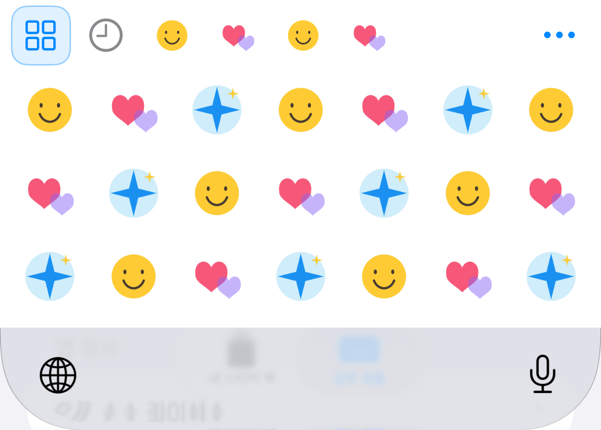
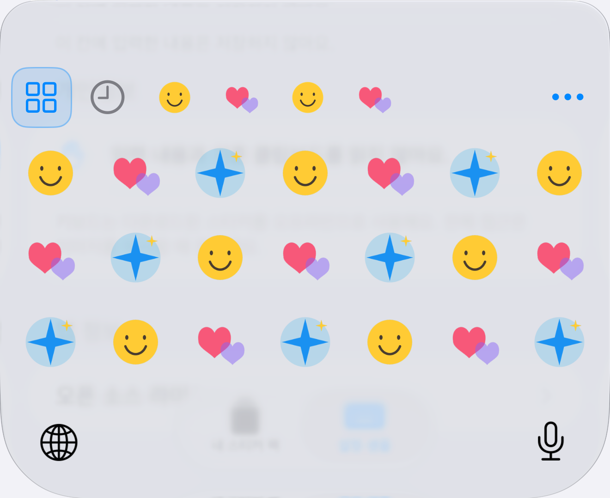

# 부분 설치와 키보드 UI 개선

2026-10-14 후속 변경: [용량 제한 제거·GIF 재생·업데이트·7×4 배치와 대화형 팩 전환](Storage-GIF-Updates-Performance.md). 아래 내용 중 정적 썸네일 전용·기존 셀 크기 관련 설명은 당시 기록입니다.

## 부분 설치

- 지원되는 항목 중 한 장 이상 성공하면 해당 항목을 설치 목록과 키보드에 표시합니다. 실패한 항목 수와 재시도 동작을 앱에 제공합니다.
- 개별 파일은 PNG/GIF 검증을 마친 뒤 완성된 revision으로 게시합니다. 미완성 파일이 키보드에 노출되는 것은 아닙니다.
- manifest에 `telegramName`, `pendingStickerIDs`를 선택적으로 추가했습니다. 기존 manifest도 계속 읽습니다.
- 재시도는 설치된 성공 항목을 공유 저장소에서 보존하고 실패 ID만 요청합니다. 앱 재시작·임시 다운로드 캐시 정리 후에도 동일합니다.
- 일부 재시도 실패 시 기존 revision을 유지합니다. 전부 실패한 새 팩은 빈 팩으로 설치하지 않습니다.
- 원격 팩에서 사라진 실패 항목은 실패 상태로 유지합니다. 기존에 설치한 성공 항목은 보존합니다.
- 취소·저장 공간 부족·마지막 인덱스 쓰기 실패·동시 삭제·오래된 revision 교체 요청은 기존 설치 내용을 덮어쓰거나 삭제한 팩을 되살리지 않습니다.

## 실제 Custom Keyboard UI

- UIKit 확장의 팩 선택 줄을 일반 크기에서 높이 36pt의 대표 이미지 탭으로 구성합니다. 전체·최근 사용은 아이콘, 개별 팩은 첫 스티커의 정적 썸네일을 사용합니다. 제목은 접근성 이름으로 제공합니다. 선택 시 팩 이름·개수 팝업을 표시하지 않습니다.
- 일반 글자 크기에서 셀 목표 크기 56pt, 간격 4pt. iPhone 15 Pro의 실제 화면에서는 6열 배치를 확인했습니다. 접근성 크기에서는 셀·탭을 확대합니다.
- 하단의 ‘전체 N · 탭해 복사’ 고정 줄을 제거했습니다. 복사·관리 결과는 그리드 위에 잠깐 표시하며 레이아웃 높이를 차지하지 않습니다. 파일·권한 오류는 다음 동작까지 표시합니다.
- 복사된 셀에 잠깐 체크 표시를 보여 줍니다. GIF 썸네일 배지와 길게 눌러 PNG 복사하는 기능을 유지합니다.
- 작은 팩 스크롤 영역의 상하좌우 scroll-edge 효과를 끄고, 스티커 그리드의 상하 효과도 끕니다. 시스템 지구본·하단 시스템 영역은 iOS가 제어합니다.
- 필요한 기기에서만 공식 다음 키보드 컨트롤을 상단에 표시합니다. 시스템 영역에 지구본이 있는 경우 확장 내부 버튼은 숨깁니다.
- 키보드 썸네일 디코딩은 기본 160px, 접근성 크기 256px, 캐시는 8MiB입니다. GIF 프레임을 키보드에서 재생하지 않습니다.

## 키보드 관리

- 팩 탭을 약 0.35초 길게 잡고 좌우로 드래그 → 손을 놓으면 순서 저장. VoiceOver에는 왼쪽/오른쪽 이동 동작을 따로 제공합니다.
- ‘…’ 관리 메뉴 또는 최근 사용 탭 길게 누르기 → 최근 사용 내역 비우기.
- ‘…’ 관리 메뉴 또는 전체 탭 길게 누르기 → 앱의 팩 순서로 되돌리기.
- 키보드 순서와 최근 내역은 확장 자신의 UserDefaults에 ID만 저장합니다. 키보드는 App Group의 팩 파일·공유 인덱스에 쓰지 않습니다.
- 키보드에서 순서를 변경하기 전에는 앱의 순서를 따릅니다. 변경 후에는 키보드 전용 순서를 유지하며, 새 팩은 끝에 추가하고 삭제된 팩은 제거합니다. 앱의 설치 목록 순서 자체는 변경하지 않습니다.
- 최근 내역을 지워도 설치된 스티커와 클립보드에는 영향을 주지 않습니다. 키보드 재시작 후에도 비운 상태를 유지합니다.

## 검증 기록

- `/tmp/StickerBridge-Partial-Device.xcresult`: iPhone의 가져오기·저장소 검사 20개 통과.
- `/tmp/StickerBridge-Compact-First.xcresult`: iPhone Simulator의 부분 설치 후 재시작·실패 항목 재시도, GIF 미리보기, PNG 공유·삭제 UI 검사 3개 통과.
- `/tmp/StickerBridge-Keyboard-Preferences.xcresult`: iPhone Simulator 단위 검사 41개 통과, 실서버 opt-in 검사 1개 생략. 순서 변경의 지속성·팩 추가/삭제·불완전한 저장소 읽기·초기화 및 최근 내역 비우기 검사 포함.
- `/tmp/StickerBridge-Compact-Regression.xcresult`: iPhone Simulator 47개 통과·1개 생략. iPad 실행 중 긴 대기로 중단하여 iPad는 39개 통과·1개 생략·취소 1개입니다. 이를 전체 통과로 기록하지 않습니다.
- 사용자 iPhone 15 Pro / iOS 27.2의 실제 키보드 화면에서 작은 6열 그리드와 팩 대표 이미지 줄을 관찰했습니다. 해당 관찰 뒤 요청에 따라 하단 줄 제거·관리 기능·스크롤 가장자리 효과 제거를 추가했습니다. 최종 상태 검증은 아래 후속 기록으로 구분합니다.

카카오톡 자동 붙여넣기는 구현하지 않습니다. 공식 Keyboard Extension API는 다른 앱의 붙여넣기 메뉴를 조작하거나 이미지를 직접 삽입하지 못합니다. 복사 후 사용자가 붙여넣습니다. 기존 Full Access 검사와 입력 내용·기존 클립보드 미수집 원칙을 유지합니다.

## 최종 후속 검증

- `/tmp/StickerBridge-iPad-Compact-Focused.xcresult`: iPad Simulator에서 부분 설치 후 재시작·재시도, 30장 그리드·공유 메뉴, 접근성 검사 **3개 통과**. 앞선 취소 검사도 후속 실행에서 통과했습니다.
- `/tmp/StickerBridge-Actual-Keyboard-UI2.xcresult`: 실제 Custom Keyboard Extension의 UIKit UI 검사 **1개 통과**. 팩 길게 누르기·좌우 이동·복사 성공·최근 사용 비우기·순서 초기화까지 실행했습니다. 앱 내부의 키보드 모형을 검사한 결과가 아닙니다.
- `/tmp/StickerBridge-Actual-Keyboard-Final.xcresult`: 위 검사에 하단 상태 줄 없음, 임시 안내가 사라짐, 가로 회전 후 그리드 크기·버튼 존재 검사를 추가해 통과했습니다. 세로 스크린샷에서 팩 이미지가 블러 없이 선명하고 7열 그리드(iPhone 18 Pro Max), 하단 고정 줄이 없는 것을 확인했습니다. 최초 가로 스크린샷이 잘려 후속 검사를 진행했습니다(아래 캡처 제한 참조).
- 첫 키보드 UI 실행(`/tmp/StickerBridge-Actual-Keyboard-UI.xcresult`)은 Simulator 하드웨어 키보드 설정으로 화면 키보드가 숨겨져 **생략**되었습니다. 화면 키보드 표시를 맞춘 뒤 위 실행들은 생략 없이 통과했습니다.
- 최종 Release 빌드 성공 후 iPhone 15 Pro에 설치했습니다. 파일·서명·Bundle ID·Team·OS 최소 버전을 유지했습니다. iPad 실기기 검증은 사용자가 보류한 상태입니다.

위 이미지는 자체 제작 샘플 53장을 설치한 iPhone Simulator의 실제 키보드 확장 스크린샷에서 키보드 영역만 잘랐습니다. UI를 합성하거나 수정하지 않았습니다.
- `/tmp/StickerBridge-Keyboard-Rotation-Final.xcresult`: 회전 후 팩 선택과 임시 안내 소멸까지 포함한 실제 확장 UI 검사 통과. 다만 XCTest의 가로 스크린샷은 다시 검은 여백과 잘린 영역으로 캡처되었습니다. 가로 레이아웃의 크기·터치 동작 통과와 가로 화면의 시각적 확인을 구분하며, 가로 시각 검증은 미완료로 남깁니다. 이 캡처 문제만을 근거로 UI 렌더링이 정상이라고 단정하지 않습니다.

## 후속 변경: 드래그·선택 복원·시스템 배경

- 개별 팩의 길게 누르기 메뉴를 드래그 정렬로 대체했습니다. 전체·최근 사용은 정렬 대상에서 제외합니다. 가장자리에서 가로 자동 스크롤하고, 손을 놓을 때 완성된 순서를 한 번 저장합니다. 취소·키보드 닫힘·회전 중에는 원래 순서로 돌아갑니다.
- 드래그하는 동안 선택한 팩은 바뀌지 않습니다. VoiceOver 사용자에게는 동등한 좌우 이동 동작을 제공합니다.
- `KeyboardSelectionStore`에 전체·최근 사용·팩 ID만 저장합니다. UI를 그리기 전에 선택 값을 읽고 첫 로컬 스냅샷을 준비합니다. 샘플을 로딩용 임시 화면으로 사용하지 않습니다.
- 같은 확장 프로세스의 새 컨트롤러는 메모리 스냅샷을 바로 사용합니다. 재진입 때 공유 인덱스 revision이 같으면 탭과 그리드를 다시 만들지 않습니다. revision이 바뀌면 완료된 새 목록으로 교체합니다.
- 공유 읽기가 일시적으로 실패하면 이미 표시한 목록을 유지합니다. 처음부터 공유 저장소를 열 수 없는 경우에는 오류를 담은 빈 상태를 사용하며 번들 샘플로 대체하지 않습니다.
- 순서 초기화는 revision과 관계없이 다시 읽어 앱의 원래 순서를 적용합니다.
- `UIInputView.Style.keyboard`를 사용하고 확장의 불투명 배경색을 제거했습니다. 스티커와 탭 뒤에 iOS 키보드 재질이 보입니다. 시스템 외곽·예약 영역과 지구본·마이크를 임의로 덮거나 제거하지 않습니다.
- 최종 Simulator에서 확장 표면은 `(0, 641, 440, 240)`, 탭은 `(8, 645, 376, 44)`였습니다. 우리 탭은 확장 표면 위에서 4pt 내려간 위치입니다. 그 위 시스템 외곽과 여백은 확장의 영역 밖입니다.
- `/tmp/StickerBridge-Drag-Final.xcresult`: **8개 통과·실패/생략 없음**. 순서/선택/최근 사용 단위 검사 7개, 실제 확장 UI 검사 1개입니다. 드래그 후 순서 및 선택 유지, 시스템 키보드 왕복, 앱 재실행 후 최근 탭과 빈 내역 복원, 초기화, 가로 화면 팩 선택을 확인했습니다.
- `XCUIScreen.main.screenshot()`으로 세로·가로 전체 화면을 확인했습니다. 앞선 `app.screenshot()` 가로 캡처 제한과 달리 이 실행에서는 가로 화면을 정상적으로 확인했습니다.
- 이번 변경의 사용자 iPhone 실기기 동작·전환 애니메이션은 별도 확인 대상입니다. Simulator의 화면 복원 검사 결과를 모든 호스트 앱에서의 무깜빡임 보장으로 확대하지 않습니다.

자체 샘플을 사용하는 실제 확장 스크린샷에서 키보드 영역만 잘랐습니다.

## 후속 변경: 상단 압축·스크롤·앱 메뉴 정리

- 일반 크기의 팩 줄 높이 44→36pt, 대표 이미지 30→22pt, 상단 여백 4→0pt, 그리드와의 간격 4→2pt, 하단 여백 4→0pt. 접근성 크기는 56pt 팩 줄을 유지합니다. 시스템 지구본이 없는 기기에서는 자체 전환 버튼의 44pt 높이를 유지합니다.
- `needsInputModeSwitchKey`를 처음 뷰를 만들 때부터 적용하고 숨긴 지구본의 높이 제약은 해제합니다. 표시 순간에 상단 줄이 잠깐 늘어나지 않도록 합니다.
- 키보드 높이는 초기 레이아웃부터 240pt(가로 200pt, 접근성 380pt) 선호값을 제공합니다. 시스템이 공간에 따라 조정할 수 있도록 필수 제약보다 낮은 우선순위를 사용합니다.
- 공유 데이터 revision이 달라졌으면 초기 메모리 캐시를 다시 읽습니다. 빈 목록·공유 접근 실패를 샘플 팩으로 대체하는 경로를 제거했습니다.
- 팩·최근 사용·전체 선택 시 개수 팝업을 제거했습니다. 복사·관리 결과와 오류 안내만 유지합니다. 개수는 접근성 이름으로만 제공합니다.
- 그리드의 터치 지연을 끄고 스크롤 취소를 허용합니다. 전체/팩에서 복사할 때 그리드와 탭을 재생성하지 않고 보이는 셀의 체크 표시만 갱신합니다. 안내가 사라질 때도 전체 reload를 하지 않습니다.
- 그리드 하단 18pt에 점진적 블러를 추가했던 기능은 후속 사용자 요청으로 제거했습니다. 시스템 지구본·마이크 아래로 뷰를 확장하지 않습니다.
- 앱의 +는 곧바로 Telegram 링크 입력 시트를 엽니다. 샘플 추가 메뉴·복사 연습·개인정보 섹션을 제거하고 탭 이름을 ‘설정’으로 바꿨습니다. 설치된 사용자 팩은 삭제하지 않습니다. 권한 설명·오픈 소스 라이선스·개인정보 미수집 동작은 유지합니다.
- UI 검사의 자체 제작 팩은 DEBUG 빌드의 명시적 `--keyboard-ui-fixture` 실행에만 설치합니다. Release에는 샘플 설치 기능이나 해당 실행 분기가 포함되지 않습니다.

### 재현과 검증 해석

- 변경 전 반복 왕복 검사는 세 번째 왕복에서 실패했습니다. 영상에는 영어/한국어만 번갈아 나타났으며, 짧은 지구본 탭이 모든 키보드를 순환한다는 잘못된 테스트 가정이 원인이었습니다. 이것을 확장 크래시나 사용자 보고의 원인으로 단정하지 않습니다.
- 전환 검사는 지구본을 길게 눌러 시스템 목록에서 StickerBridge를 선택하도록 변경했습니다. 최종 프레임의 선택 복원과 전환 영상의 시각적 관찰을 구분합니다. 모든 타사 앱에서 간헐적 깜빡임이 사라졌다고 보장하지 않습니다.

### 이번 변경의 실행 결과

- `/tmp/StickerBridge-Compact-Scroll.xcresult`: UI 검사 **4개 통과**, 실패·생략 없음. 60장/45장 각각 선택 후 끝까지 스크롤하고 처음으로 복귀, 개수 팝업 없음, 드래그 정렬·최근 내역 삭제·선택 복원·가로 회전, +의 Telegram 입력 직접 연결 및 설정 항목 제거를 확인했습니다.
- `/tmp/StickerBridge-Compact-App-Regression.xcresult`: **9개 통과**, 실패·생략 없음. 가져오기·부분 설치 재시도·복사/공유·앱 재시작·온보딩·가로 설정·접근성 UI 7개 및 최근 사용 단위 검사 2개입니다.
- `/tmp/StickerBridge-Compact-Transition-Final.xcresult`: **6개 통과**, 실패·생략 없음. 최근 사용에 두 장을 복사한 뒤 시스템 키보드 목록으로 5회 왕복하는 실제 확장 UI 검사 1개 및 순서·선택·최근 내역 관련 단위 검사 5개입니다.
- `/tmp/StickerBridge-Compact-Transition-Final.mov`: 위 5회 왕복 녹화. 각 재진입의 첫 스티커 표시 프레임부터 최근 사용 두 장이 표시됐으며, 전체 팩/번들 샘플이 끼어드는 화면은 관찰하지 못했습니다. Simulator의 단일 호스트 앱 결과이며, 사용자 iPhone의 모든 앱에서 간헐적 깜빡임이 사라졌다는 판정은 아닙니다.
- 최종 세로 geometry: 확장 `(0,641,440,240)`, 팩 줄 `(8,641,376,36)`, 그리드 `(8,679,424,202)`. 기존 그리드 높이 184pt에서 202pt로 18pt 늘었습니다. 세로·가로 스크린샷에서 작은 탭과 하단 fade, 시스템 버튼 보존을 확인했습니다.
- `/tmp/StickerBridge-compact-final-release2.log`: Release 빌드 성공. iPhone 15 Pro / iOS 27.2에 최종 설치·앱 실행 성공, 로컬 서명 검증 통과. 사용자 데이터는 삭제하지 않았습니다. 새 버전의 타사 앱별 수동 전환·스크롤 결과와 iPad 실기기 검증은 아직 없습니다.

- `/tmp/StickerBridge-Compact-GIF-Scroll.xcresult`: 최종 UIKit 코드에서 정적 60장 팩과 GIF 45장 팩을 각각 선택해 왕복 스크롤하는 검사 **1개 통과**, 실패·생략 없음. GIF 팩의 실제 컨텍스트 메뉴에서 ‘정적 PNG로 복사’도 실행해 정상 복사 안내를 확인했습니다. 테스트 팩 B는 DEBUG fixture에서 자체 TGS를 변환한 GIF 경로를 갖습니다.

## 후속 변경: 블러 제거·대각선 터치·좌우 팩 전환

- 하단 `KeyboardBottomFade`와 관련 뷰·마스크·스크롤 갱신 콜백을 전부 제거했습니다.
- 방향 잠금을 끄고 가로 바운스를 막았습니다. 이것만으로는 재현된 멈춤이 해결되지 않아 추가 진단했습니다.
- 완전히 clear인 키보드 배경에서 특정 투명 이미지 여백의 터치가 확장에 전달되지 않는 현상을 재현했습니다. 같은 좌표에 배경을 채우면 스크롤이 회복됐습니다. OS 내부의 터치 전달 원리를 단정하지 않으며, A/B 검사 결과에 근거해 `systemBackground`의 1% 농도만 적용했습니다. 스티커 자체의 alpha나 뷰 전체의 alpha를 낮추는 변경이 아닙니다.
- UIKit 기본 `UIInputView`/`UICollectionView`를 그대로 사용합니다. 진단용 hit-test override, 터치 프로브, 좌표 로그, 접근성 진단 값은 제거했습니다.
- 스티커 영역에서 왼쪽으로 밀면 다음 탭, 오른쪽으로 밀면 이전 탭으로 전환합니다. 순서는 상단에 표시되는 전체 → 최근 사용 → 사용자 팩 순서를 따르고, 처음·끝에서 순환하지 않습니다.
- 가로 속도가 세로 속도의 두 배를 넘을 때만 팩 전환 제스처를 시작합니다. 나머지는 기본 세로 스크롤이 처리합니다. 가로 이동 44pt 이상 또는 20pt 이상과 충분한 속도가 있을 때 손을 놓으며 전환합니다. 짧은 이동·취소는 선택을 바꾸지 않습니다.
- 기본 세로 pan은 가로 전환 판정이 실패한 뒤 시작하도록 공식 recognizer dependency를 사용합니다. UIKit 소유 pan의 delegate는 교체하지 않습니다. 팩 탭의 드래그 정렬과 GIF 길게 누르기 메뉴도 유지합니다.
- 스와이프로 선택한 탭도 기존 선택 저장 경로를 사용합니다. 팩/개수 팝업은 추가하지 않습니다.

### 원인 확인에 사용한 실행 기록

- `/tmp/StickerBridge-Diagonal-Baseline.xcresult`: 기존 코드에서 대각선 실패 재현. 오른쪽 위 방향은 기준 셀이 y=801→720으로 이동했으나, 왼쪽 위는 801→801로 멈췄습니다.
- `/tmp/StickerBridge-Diagonal-Fixed.xcresult`, `/tmp/StickerBridge-Diagonal-Pan.xcresult`: 방향 잠금 해제·pan 시작 override만으로는 실패했습니다. 이 상태를 수정 완료로 판정하지 않았습니다.
- `/tmp/StickerBridge-Gestures-Opaque-Probe.xcresult`: 배경을 채운 A/B 진단에서 정적/GIF 두 팩 각각 네 방향 대각선 왕복 검사 통과.
- `/tmp/StickerBridge-Gestures-Near-Clear.xcresult`: 진단용 코드를 제거하고 1% 배경을 적용한 실제 구현에서 대각선·좌우 전환 UI 검사 2개 통과. 원래 멈추던 하단 좌표에서도 정적 60장/GIF 45장 팩 모두 이동했습니다.
